<picture>
  <source media="(max-width: 600px)" srcset="./assets/neural-hero-mobile.svg" />
  
</picture>

# Hady Abohany · AI Engineer

**I build AI assistants that connect language models to documents, databases and application state.**

[Projects](#featured-projects) · [Expertise](#ai-expertise) · [Background](#experience-and-education) · [Contact](#contact)

## About me

My work focuses on large language models, retrieval-augmented generation and tool-using agents: from a bilingual science companion to an e-commerce assistant that queries products and creates orders. I build the Python APIs, retrieval pipelines and interfaces that connect these systems, with attention to evidence, explicit contracts and fallback behavior.

## Featured projects

<table width="100%"><tr><td>
<h3>01 · NOVA / SURVORA</h3>

<strong>A bilingual AI companion for a Mars learning experience.</strong>

<strong>Problem:</strong> Players need science explanations and mission help that reflect the game state.

<strong>Solution:</strong> A FastAPI companion combines a read-only game snapshot with curated NASA and CSA references. BM25 retrieval, optional semantic search and Gemini dialogue sit alongside deterministic event responses.

<strong>My contribution:</strong> Organized the NOVA backend, knowledge corpus, API integration documentation and sample Unity bridge in the SURVORA monorepo.

<code>Python</code> <code>FastAPI</code> <code>Pydantic</code> <code>Gemini</code> <code>BM25</code>

<a href="https://github.com/HadyAbohany/SURVORA"><strong>Explore repository →</strong></a> · <a href="https://github.com/hadyahmedabdelhady/NOVA-Backend">Standalone backend</a>

</td></tr></table>

Engineering details · state, retrieval and response checks

The [response assembler](https://github.com/HadyAbohany/SURVORA/blob/main/backend/app/assistant.py) checks returned reference IDs and suggested actions against the supplied evidence and allowlist. The [retriever](https://github.com/HadyAbohany/SURVORA/blob/main/backend/app/retrieval.py) supports optional ChromaDB and multilingual embeddings. [Integration tests](https://github.com/HadyAbohany/SURVORA/blob/main/backend/tests/test_integration.py) cover contracts, fallback paths and event behavior.

**Scope:** Companion backend and sample bridge; the complete Unity game is not included in this repository.

<table width="100%"><tr><td>
<h3>02 · E-commerce AI Agent</h3>

<strong>From store questions to database-backed actions.</strong>

<strong>Problem:</strong> Customer support needs both policy knowledge and current product, stock and order data.

<strong>Solution:</strong> A Gemini function-calling loop selects PostgreSQL tools or policy retrieval through one chat API. Policy search combines BM25, semantic retrieval and cross-encoder reranking; order creation writes to the database and updates stock.

<strong>My contribution:</strong> Developed the agent project and browser clients, connecting database tools, bilingual policy retrieval and session-based conversations.

<code>Python</code> <code>FastAPI</code> <code>PostgreSQL</code> <code>SQLAlchemy</code> <code>ChromaDB</code>

<a href="https://github.com/HadyAbohany/Ecommerce-AI-Agent"><strong>Explore repository →</strong></a>

</td></tr></table>

Engineering details · tool dispatch and policy retrieval

Inspect the [bounded tool loop](https://github.com/HadyAbohany/Ecommerce-AI-Agent/blob/main/app/agent/core.py), [database operations](https://github.com/HadyAbohany/Ecommerce-AI-Agent/blob/main/app/db/queries.py) and [hybrid policy retriever](https://github.com/HadyAbohany/Ecommerce-AI-Agent/blob/main/app/rag/retriever.py).

**Scope:** Portfolio prototype with in-memory conversation history. Browser channel demos are included; live WhatsApp and Telegram integrations are future extensions.

<table width="100%"><tr><td>
<h3>03 · ClinicalAI</h3>

<strong>Traceable retrieval over NICE clinical guidelines.</strong>

<strong>Problem:</strong> Long guideline documents make relevant recommendations difficult to locate and inspect.

<strong>Solution:</strong> A guideline-retrieval prototype combines semantic search, BM25, rank fusion and reranking, then passes retrieved evidence to Gemini. A Streamlit interface exposes answers and supporting document context.

<strong>My contribution:</strong> Added evaluation work, Streamlit screens and document support, then refined the consultation, knowledge-base and system-status interfaces.

<code>Python</code> <code>FastAPI</code> <code>Streamlit</code> <code>ChromaDB</code> <code>Sentence Transformers</code>

<a href="https://github.com/HadyAbohany/Diabetic-Foot-RAG"><strong>Explore repository →</strong></a>

</td></tr></table>

Engineering details · evidence and evaluation

The [generation pipeline](https://github.com/HadyAbohany/Diabetic-Foot-RAG/blob/main/src/generation.py) includes query rewriting and refusal paths. [Retrieval evaluation](https://github.com/HadyAbohany/Diabetic-Foot-RAG/blob/main/src/evaluate.py) and [generation evaluation](https://github.com/HadyAbohany/Diabetic-Foot-RAG/blob/main/src/generation_eval.py) inspect ranking, cited pages and abstention behavior.

**Scope:** An engineering prototype for guideline exploration, not clinically validated decision software.

<table width="100%"><tr><td>
<h3>04 · Dynamic RAG</h3>

<strong>Turn an uploaded guideline into a searchable knowledge base.</strong>

<strong>Problem:</strong> A fixed guideline collection cannot answer questions about a newly supplied document.

<strong>Solution:</strong> PDF upload creates a document-specific ChromaDB collection and BM25 index. Weighted reciprocal rank fusion and cross-encoder reranking select context for answers with document, section and page metadata.

<strong>My contribution:</strong> Published the document-upload evolution of the clinical RAG workflow, with FastAPI upload/query endpoints and a dedicated Streamlit interface.

<code>Python</code> <code>PyMuPDF</code> <code>ChromaDB</code> <code>FastAPI</code> <code>Streamlit</code>

<a href="https://github.com/HadyAbohany/DynamicRAG"><strong>Explore repository →</strong></a>

</td></tr></table>

Engineering details · document ingestion and ranking

See the [upload and query API](https://github.com/HadyAbohany/DynamicRAG/blob/main/api/main.py), [PDF ingestion](https://github.com/HadyAbohany/DynamicRAG/blob/main/src/ingestion.py) and [ranking pipeline](https://github.com/HadyAbohany/DynamicRAG/blob/main/src/retrieval.py).

**Scope:** The parser is optimized for numbered guideline recommendations such as `1.x.x`. Session metadata is held in memory. This project extends the clinical RAG work above.

## AI expertise

- **LLMs and AI agents:** Gemini integration, function calling, tool dispatch, structured responses and conversation state.
- **RAG and retrieval:** PDF ingestion, document chunking, BM25, dense retrieval, rank fusion, cross-encoder reranking and evidence metadata.
- **Machine learning:** Applying pretrained embedding and ranking models; comparing retrieval strategies and inspecting evaluation results.
- **Backend and deployment:** FastAPI contracts, Pydantic validation, PostgreSQL, SQLAlchemy, Docker Compose and backend integration tests.

## Tech stack

  
  
  
  

**AI and retrieval** · Gemini · Sentence Transformers · ChromaDB · BM25

**Backend and data** · Python · FastAPI · Pydantic · PostgreSQL · SQLAlchemy

**Interfaces and tooling** · Streamlit · JavaScript · Docker Compose · Git

Additional familiarity

LangChain — retained from my previous profile. The featured implementations primarily use direct model SDKs and custom retrieval pipelines.

## Experience and education

- **AI engineering project work:** Retrieval systems, agent tools and backend integration across the projects above.
- **DEPI graduation-project planning:** Contributed to the [Olist business analytics project](https://github.com/HadyAbohany/End-to-End-Business-Analytics-Decision-Platform). Its Phase 1–3 plan lists me as team leader, with proposed FastAPI and frontend responsibilities; the public repository currently contains planning documentation.
- **Education:** Systems & Computers Engineering.

## GitHub activity

Explore my [public repositories](https://github.com/HadyAbohany?tab=repositories) and [contribution activity](https://github.com/HadyAbohany). Each featured repository includes its commit history and implementation details.

## Contact

For AI engineering opportunities and project collaboration:

**[hadyabohany@gmail.com](mailto:hadyabohany@gmail.com)** · **[GitHub · HadyAbohany](https://github.com/HadyAbohany)**
